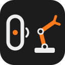

<p align="center">English · <a href="README.tr.md">Türkçe</a></p>

<p align="center">
  
</p>

<h1 align="center">so101-band</h1>

<p align="center"><b>Drive your SO-101 robot arm from the Huawei Band 6 on your wrist.</b><br>
One tap, one pose. Built on <a href="https://github.com/fport/openband">Openband</a> and
<a href="https://github.com/fport/so101-remote">so101-remote</a>.</p>

<p align="center">
  <a href="LICENSE"></a>
  
  <a href="https://github.com/fport/so101-band/actions/workflows/ci.yml"></a>
  <a href="https://github.com/TheRobotStudio/SO-ARM100"></a>
  
  
</p>

**Status:** early, and it moves a real arm: a tap on the band steps an SO-101 through its poses
([video](https://youtube.com/shorts/GymCK7wRA0I)). Every path is covered by tests against a simulated
arm and a simulated band as well, and the poses that ship are measured on my arm, not yours — record
your own before the first `--live` run.

## Start

You need a band paired with [Openband](https://github.com/fport/openband) (`openband pair`) and a calibrated SO-101 follower on its 12 V supply.

```bash
git clone https://github.com/fport/so101-band && cd so101-band
uv sync
uv run so101-band init            # writes ~/.config/so101-band/config.toml
uv run so101-band poses           # poses, routines, the tap sequence, the buttons
uv run so101-band run --stdin     # no band, no arm: type find, next, pause, volume_up ...
uv run so101-band run             # the band, dry run: each tap prints what would go to the arm
uv run so101-band run --live      # each tap moves the arm
```

Run it from Terminal or iTerm: it starts `openband listen`, which needs macOS's Bluetooth permission
(Warp and some IDE shells do not get it). Wake the band's screen so it connects, then open **Find phone**
on the band and tap.

The arm starts limp. The first tap turns torque on exactly where the arm is, then it moves to the first
pose. **Ctrl+C** folds the arm into its rest pose and lets go.

> [!WARNING]
> Start with a dry run, then go live with the workspace clear and a hand near the arm. A torque-off
> (play / pause on the music screen) parks the arm first; a power cut or a pulled cable drops it.

## Why

The band is on your wrist anyway, and a tap on it is a button you cannot lose. Openband already turns
taps into lines on a terminal and so101-remote already moves the arm gently, inside its calibration.
so101-band joins the two: no leader arm, no keyboard, no screen next to the robot.

| | |
| --- | --- |
| 👆 **One tap, one step** | "Find phone" steps through a pose sequence: home → wave → reach → home |
| 🎵 **Music screen** | next / previous step, play / pause turn torque on and off, volume nudges a joint |
| ⌚ **Feedback on the wrist** | after each action the band shows what happened: "pose 3/4: reach" |
| 🛡️ **Gentle** | limits from the calibration in the motors, narrower ones from the config, a top speed, every joint arriving together |
| 🛑 **Clean stop** | Ctrl+C, or the band listener ending: fold into rest, then torque off |
| 🧪 **Dry run by default** | without `--live` nothing reaches the arm; a simulated follower prints what would |
| 📍 **Record poses** | `so101-band record NAME` saves where the arm is now (reads only) |

## The buttons

| On the band | Default action |
| --- | --- |
| Find phone (the Band 6's only button) | `next`: the next step of the sequence |
| Music: next / previous | `next` / `previous` |
| Music: play / pause | `torque`: on, holding where it is; off, after parking in "rest" |
| Music: volume up / down | `nudge:+5` / `nudge:-5`: the nudge joint (wrist roll) by 5° |

Everything is in the config: poses, routines (a list of poses with optional holds), the sequence, and the
action of each button (`next`, `previous`, `pose:NAME`, `routine:NAME`, `torque`, `stop`, `joint`,
`nudge:±N`, `none`). Start from [the example](src/so101_band/config.example.toml).

## Record a pose

```bash
uv run so101-band record grab     # move the limp arm by hand first
uv run so101-band record grab --port /dev/cu.usbmodem5AB01794851
```

It reads the six positions and writes `grab = { ... }` into the `[poses]` table of your config, keeping
your comments. It never writes to the motors. The arm is limp after power-up and after `so101-band run`
ends; then add `grab` to `[sequence]` or a button.

## More

<details>
<summary><b>What it reuses</b></summary>

- **Openband** (`openband listen`): one JSON line per tap, e.g.
  `{"ts": 1794152946, "button": "find", "code": 0, "volume": null}`. so101-band runs it as a child
  process and sends feedback with `openband notify TITLE TEXT --no-bluetooth`, which goes through the
  running listener instead of opening Bluetooth again.
- **so101-remote**'s bridge, unchanged and pinned: Feetech motors over the SDK LeRobot uses, limits read
  from the motors' `Min/Max_Position_Limit` (your LeRobot calibration) with ~2.6° kept from each stop,
  torque on at the present position, 50 % gripper torque, a blocked-joint check, the rest-then-release
  shutdown and the gestures (wave, dance, yes, no). so101-band subclasses its `Bridge` and gives it the band
  as the remote, where the ESP32 screen used to be.

Angles are degrees from the calibration middle pose (the arm standing in its "L"); the gripper is percent
open. Nothing is written to EEPROM: calibration stays as LeRobot left it.

</details>

<details>
<summary><b>How it keeps the arm safe</b></summary>

- Nothing moves until the first tap, and the first tap starts from where the arm is: no jump.
- Every target is clamped to the calibrated range and to `[arm.limits]`; `run` warns about poses that
  reach past a limit.
- `arm.max_speed_deg_s` (default 30, at most 90) caps the shoulder and elbow; the wrist may go 1.5×, roll
  and gripper 2×. Each move is a straight line in joint space: the joint with the longest way sets the pace
  and all joints arrive together. The motors' acceleration setting softens start and stop.
- A joint more than ~22° behind its goal for 0.8 s is blocked: the arm holds and the band says so. The next
  tap only clears the fault (a find-only band has no stop button); the one after that moves again.
- Ctrl+C or `kill`: the arm folds into rest at the slowest speed (25°/s) and torque goes off. A second
  Ctrl+C lets go at once. If `openband listen` exits, the current move finishes first, then the same.

</details>

<details>
<summary><b>Options</b></summary>

| `so101-band run` | |
| --- | --- |
| `--live` / `--dry-run` | move the arm / only print (default) |
| `--port PORT` | follower port; default: `arm.port`, else the arm on 12 V |
| `--max-speed DEG_S` | top speed for this run |
| `--listen-cmd CMD` / `--notify-cmd CMD` | instead of `openband.listen` / `openband.notify` |
| `--no-notify` | no feedback on the band |
| `--stdin` | button names from the keyboard instead of the band |

`--config PATH` (or `$SO101_BAND_CONFIG`) picks another config; without one the bundled example is used.

</details>

<details>
<summary><b>Troubleshooting</b></summary>

| Symptom | Likely cause |
| --- | --- |
| `openband listen exited with code 134` | No Bluetooth permission: run from Terminal or iTerm |
| Taps do nothing | The band is not connected: wake its screen; Openband keeps retrying |
| `No follower found` | 12 V supply off, or pass `--port /dev/cu.usbmodem…` |
| `band notify failed` | `openband listen` was not up yet; the arm still moves |
| A joint goes the wrong way | The example poses are not measured on your arm: record your own |

</details>

- `uv run pytest`: the tests, all without hardware.

## License

MIT. Builds on [Openband](https://github.com/fport/openband) for the band and
[so101-remote](https://github.com/fport/so101-remote) for the arm, which uses Feetech's SDK and LeRobot's
calibration.
