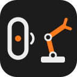

<p align="center"><a href="README.md">English</a> · Türkçe</p>

<p align="center">
  
</p>

<h1 align="center">so101-band</h1>

<p align="center"><b>SO-101 robot kolunu bileğindeki Huawei Band 6 ile yönet.</b><br>
Bir dokunuş, bir poz. <a href="https://github.com/fport/openband">Openband</a> ve
<a href="https://github.com/fport/so101-remote">so101-remote</a> üzerine kurulu.</p>

<p align="center">
  <a href="LICENSE"></a>
  
  <a href="https://github.com/fport/so101-band/actions/workflows/ci.yml"></a>
  <a href="https://github.com/TheRobotStudio/SO-ARM100"></a>
  
  
</p>

**Durum:** erken. Her yol simüle bir kol ve simüle bir bileklikle testlerle kapsanıyor, kuru çalıştırma
uçtan uca çalışıyor; gerçek bir kolu henüz hareket ettirmedi.

## Başla

[Openband](https://github.com/fport/openband) ile eşlenmiş bir bileklik (`openband pair`) ve 12 V beslemesine bağlı, kalibre edilmiş bir SO-101 follower gerekiyor.

```bash
git clone https://github.com/fport/so101-band && cd so101-band
uv sync
uv run so101-band init            # ~/.config/so101-band/config.toml dosyasını yazar
uv run so101-band poses           # pozlar, rutinler, dokunuş sırası, tuşlar
uv run so101-band run --stdin     # bileklik yok, kol yok: find, next, pause, volume_up ... yaz
uv run so101-band run             # bileklik, kuru çalıştırma: her dokunuş kola gidecek olanı yazdırır
uv run so101-band run --live      # her dokunuş kolu hareket ettirir
```

Terminal ya da iTerm'den çalıştır: `openband listen`'ı başlatıyor, o da macOS'un Bluetooth iznine ihtiyaç
duyuyor (Warp ve bazı IDE kabukları bu izni alamıyor). Bağlansın diye bilekliğin ekranını uyandır, sonra
bileklikte **Telefonu bul**'u aç ve dokun.

Kol gevşek başlar. İlk dokunuş torku kol tam neredeyse orada açar, sonra kol ilk poza gider.
**Ctrl+C** kolu dinlenme pozuna katlar ve bırakır.

> [!WARNING]
> Önce kuru çalıştır, sonra çalışma alanı boşken ve elin kolun yakınındayken canlıya geç. Tork kapatma
> (müzik ekranında oynat / duraklat) kolu önce park eder; elektrik kesilirse ya da kablo çıkarsa kol düşer.

## Neden

Bileklik zaten kolunda ve üstündeki bir dokunuş kaybedemeyeceğin bir tuş. Openband dokunuşları terminalde
satırlara çeviriyor, so101-remote kolu kalibrasyonunun içinde, yumuşakça hareket ettiriyor. so101-band
ikisini birleştiriyor: lider kol yok, klavye yok, robotun yanında ekran yok.

| | |
| --- | --- |
| 👆 **Bir dokunuş, bir adım** | "Telefonu bul" poz sırasında ilerler: home → wave → reach → home |
| 🎵 **Müzik ekranı** | sonraki / önceki adım, oynat / duraklat torku açar-kapatır, ses bir eklemi oynatır |
| ⌚ **Bilekte geri bildirim** | her eylemden sonra bileklik ne olduğunu gösterir: "pose 3/4: reach" |
| 🛡️ **Yumuşak** | motorlardaki kalibrasyondan sınırlar, config'ten daha dar sınırlar, azami hız, tüm eklemler aynı anda varır |
| 🛑 **Temiz duruş** | Ctrl+C ya da bileklik dinleyicisinin kapanması: dinlenme pozuna katla, sonra torku kapat |
| 🧪 **Varsayılan kuru çalıştırma** | `--live` olmadan kola hiçbir şey gitmez; simüle bir follower gidecek olanı yazdırır |
| 📍 **Poz kaydı** | `so101-band record AD` kolun şu anki yerini kaydeder (sadece okur) |

## Tuşlar

| Bileklikte | Varsayılan eylem |
| --- | --- |
| Telefonu bul (Band 6'nın tek tuşu) | `next`: sıranın sonraki adımı |
| Müzik: sonraki / önceki | `next` / `previous` |
| Müzik: oynat / duraklat | `torque`: açıkken olduğu yerde tutar; kapatırken önce "rest"e park eder |
| Müzik: ses aç / kıs | `nudge:+5` / `nudge:-5`: seçili eklemi (bilek dönüşü) 5° oynatır |

Her şey config'te: pozlar, rutinler (isteğe bağlı bekleme süreli poz listesi), sıra ve her tuşun eylemi
(`next`, `previous`, `pose:AD`, `routine:AD`, `torque`, `stop`, `joint`, `nudge:±N`, `none`).
[Örnekten](src/so101_band/config.example.toml) başla.

## Poz kaydet

```bash
uv run so101-band record grab     # önce gevşek kolu elle konumlandır
uv run so101-band record grab --port /dev/cu.usbmodem5AB01794851
```

Altı eklemin konumunu okur ve config'teki `[poses]` tablosuna `grab = { ... }` yazar; yorumların kalır.
Motorlara asla yazmaz. Kol açılışta ve `so101-band run` bittikten sonra gevşektir; sonra `grab`'i
`[sequence]`'e ya da bir tuşa ekle.

## Daha fazlası

<details>
<summary><b>Neyi yeniden kullanıyor</b></summary>

- **Openband** (`openband listen`): her dokunuşta bir JSON satırı, ör.
  `{"ts": 1794152946, "button": "find", "code": 0, "volume": null}`. so101-band onu alt süreç olarak
  çalıştırır ve geri bildirimi `openband notify BAŞLIK METİN --no-bluetooth` ile gönderir; bu, Bluetooth'u
  yeniden açmak yerine çalışan dinleyicinin üzerinden gider.
- **so101-remote**'un köprüsü, değiştirilmeden ve sabitlenmiş sürümüyle: LeRobot'un kullandığı SDK ile
  Feetech motorları, motorların `Min/Max_Position_Limit` değerlerinden (LeRobot kalibrasyonun) okunan,
  her uçtan ~2,6° pay bırakılmış sınırlar, mevcut konumda açılan tork, %50 kıskaç torku, sıkışan eklem
  kontrolü, önce dinlenme sonra bırakma kapanışı ve hareketler (wave, dance, yes, no). so101-band onun
  `Bridge` sınıfından türetir ve ESP32 ekranın yerine kumanda olarak bilekliği verir.

Açılar kalibrasyon orta pozundan (kolun "L" şeklinde durduğu poz) derece cinsindendir; kıskaç yüzde kaç
açık olduğudur. EEPROM'a hiçbir şey yazılmaz: kalibrasyon LeRobot'un bıraktığı gibi kalır.

</details>

<details>
<summary><b>Kolu nasıl güvende tutuyor</b></summary>

- İlk dokunuşa kadar hiçbir şey hareket etmez ve ilk dokunuş kolun olduğu yerden başlar: sıçrama yok.
- Her hedef kalibre edilmiş aralığa ve `[arm.limits]`'e kırpılır; `run`, sınırın dışına uzanan pozlar için
  uyarır.
- `arm.max_speed_deg_s` (varsayılan 30, en fazla 90) omuz ve dirseği sınırlar; bilek 1,5×, dönüş ve kıskaç
  2× gidebilir. Her hareket eklem uzayında düz bir çizgidir: en uzun yolu olan eklem hızı belirler ve tüm
  eklemler aynı anda varır. Motorların ivme ayarı kalkışı ve duruşu yumuşatır.
- Hedefinin ~22° gerisinde 0,8 sn kalan eklem sıkışmıştır: kol durur ve bileklik bunu söyler. Sonraki
  dokunuş sadece hatayı temizler (sadece "bul" tuşu olan bileklikte durdurma tuşu yok); ondan sonraki yine
  hareket ettirir.
- Ctrl+C ya da `kill`: kol en yavaş hızla (25°/sn) dinlenme pozuna katlanır ve tork kapanır. İkinci Ctrl+C
  hemen bırakır. `openband listen` kapanırsa önce süren hareket biter, sonra aynısı olur.

</details>

<details>
<summary><b>Seçenekler</b></summary>

| `so101-band run` | |
| --- | --- |
| `--live` / `--dry-run` | kolu hareket ettir / sadece yazdır (varsayılan) |
| `--port PORT` | follower portu; varsayılan: `arm.port`, yoksa 12 V'taki kol |
| `--max-speed DERECE_SN` | bu çalıştırma için azami hız |
| `--listen-cmd KOMUT` / `--notify-cmd KOMUT` | `openband.listen` / `openband.notify` yerine |
| `--no-notify` | bileklikte geri bildirim yok |
| `--stdin` | tuş adları bileklik yerine klavyeden |

`--config YOL` (ya da `$SO101_BAND_CONFIG`) başka bir config seçer; config yoksa paketteki örnek kullanılır.

</details>

<details>
<summary><b>Sorun giderme</b></summary>

| Belirti | Olası neden |
| --- | --- |
| `openband listen exited with code 134` | Bluetooth izni yok: Terminal ya da iTerm'den çalıştır |
| Dokunuşlar bir şey yapmıyor | Bileklik bağlı değil: ekranını uyandır; Openband denemeye devam eder |
| `No follower found` | 12 V besleme kapalı, ya da `--port /dev/cu.usbmodem…` ver |
| `band notify failed` | `openband listen` henüz ayakta değildi; kol yine de hareket eder |
| Bir eklem ters yöne gidiyor | Örnek pozlar senin kolunda ölçülmedi: kendi pozlarını kaydet |

</details>

- `uv run pytest`: testler, hepsi donanımsız.

## Lisans

MIT. Bileklik için [Openband](https://github.com/fport/openband), kol için Feetech'in
SDK'sını ve LeRobot'un kalibrasyonunu kullanan [so101-remote](https://github.com/fport/so101-remote)
üzerine kurulu.
